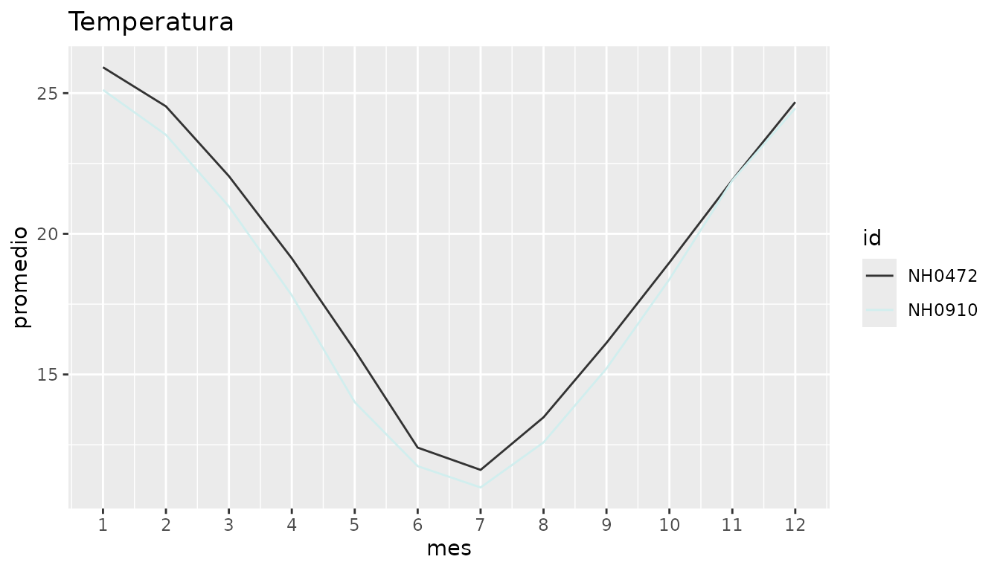
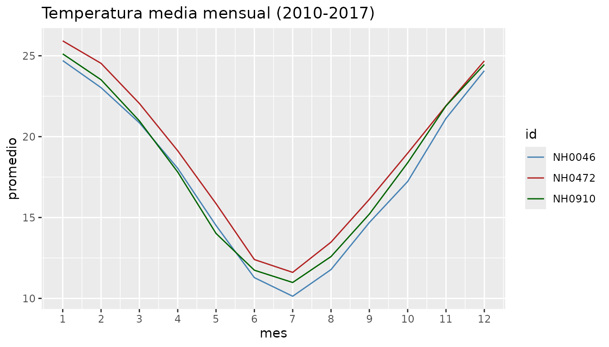
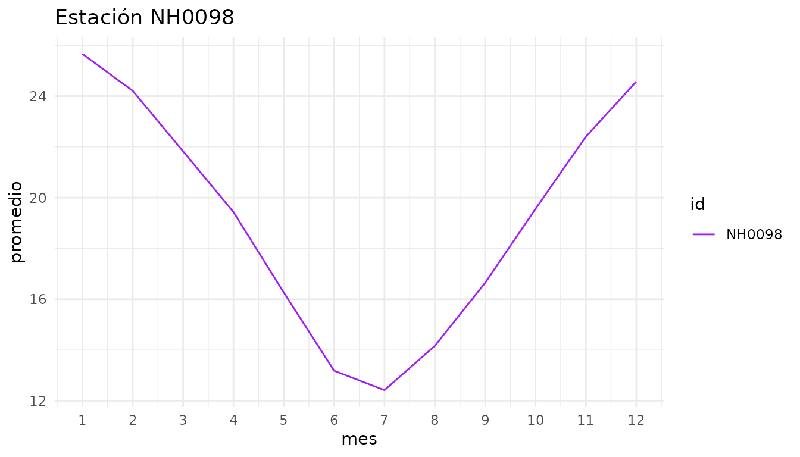

# Introducción a cienciademetadatosR

`cienciademetadatosR` es un paquete para descargar, resumir y graficar
datos meteorológicos diarios de estaciones del INTA. En esta viñeta
mostramos el flujo de trabajo completo: obtener los datos, resumirlos en
una tabla y visualizar cómo varía la temperatura a lo largo del año.

``` r

library(cienciademetadatosR)
```

## Los datos incluidos en el paquete

El paquete trae el conjunto de datos `estaciones`. Tiene registros
diarios de temperatura de 5 estaciones meteorológicas entre 2010 y 2017.
Es un recorte de los datos originales y sirve para probar las funciones
sin descargar nada.

``` r

head(estaciones)
#>       id      fecha temperatura_abrigo_150cm temperatura_abrigo_150cm_maxima
#> 1 NH0472 2010-01-01                    23.35                            27.5
#> 2 NH0472 2010-01-02                    23.85                            31.9
#> 3 NH0472 2010-01-03                    26.00                            31.8
#> 4 NH0472 2010-01-04                    28.00                            34.5
#> 5 NH0472 2010-01-05                    27.50                            36.1
#> 6 NH0472 2010-01-06                    22.05                            25.5
#>   temperatura_abrigo_150cm_minima
#> 1                            19.2
#> 2                            15.8
#> 3                            20.2
#> 4                            21.5
#> 5                            18.9
#> 6                            18.6
```

Cada fila es un día en una estación. Las columnas son:

- `id`: identificador de la estación (por ejemplo `"NH0472"`).
- `fecha`: día de la medición.
- `temperatura_abrigo_150cm`: temperatura media del día (°C).
- `temperatura_abrigo_150cm_maxima`: temperatura máxima del día (°C).
- `temperatura_abrigo_150cm_minima`: temperatura mínima del día (°C).

Para ver qué estaciones hay disponibles:

``` r

unique(estaciones$id)
#> [1] "NH0472" "NH0910" "NH0046" "NH0098" "NH0437"
```

## Descargar datos de otras estaciones

Si se necesitan datos completos o de otra estación,
[`leer_datos()`](https://joaquin0307.github.io/cienciademetadatosR/reference/leer_datos.md)
descarga el archivo desde el repositorio del curso, lo guarda en la ruta
indicada en `destino` y lo devuelve como un data frame.

``` r

datos_nh0046 <- leer_datos(id_estacion = "NH0046", destino = "NH0046.csv")
head(datos_nh0046)
```

> Este bloque no se ejecuta al construir la viñeta porque necesita
> conexión a internet.

## Resumen de temperaturas por estación

[`tabla_resumen_temperatura()`](https://joaquin0307.github.io/cienciademetadatosR/reference/tabla_resumen_temperatura.md)
calcula, para cada estación, la temperatura mínima y máxima registradas,
el promedio y el desvío estándar de la temperatura media.

Con una sola estación:

``` r

tabla_resumen_temperatura(estaciones, ids = "NH0472")
#> # A tibble: 1 × 5
#>   id     temp_minima temp_maxima promedio desvio
#>   <chr>        <dbl>       <dbl>    <dbl>  <dbl>
#> 1 NH0472          -6        40.6     19.0   5.94
```

Con varias estaciones a la vez, para compararlas:

``` r

tabla_resumen_temperatura(estaciones, ids = c("NH0472", "NH0910", "NH0046"))
#> # A tibble: 3 × 5
#>   id     temp_minima temp_maxima promedio desvio
#>   <chr>        <dbl>       <dbl>    <dbl>  <dbl>
#> 1 NH0046        -5.7        38.8     17.5   6.05
#> 2 NH0472        -6          40.6     19.0   5.94
#> 3 NH0910        -7.5        43       18.0   6.22
```

Si no se indican `ids`, se resumen todas las estaciones del data frame:

``` r

tabla_resumen_temperatura(estaciones)
#> # A tibble: 5 × 5
#>   id     temp_minima temp_maxima promedio desvio
#>   <chr>        <dbl>       <dbl>    <dbl>  <dbl>
#> 1 NH0046        -5.7        38.8     17.5   6.05
#> 2 NH0098        -6.4        42       19.1   5.86
#> 3 NH0437        -3.4        41.5     20.5   5.76
#> 4 NH0472        -6          40.6     19.0   5.94
#> 5 NH0910        -7.5        43       18.0   6.22
```

## Gráfico de la temperatura mensual

[`grafico_temperatura_mensual()`](https://joaquin0307.github.io/cienciademetadatosR/reference/grafico_temperatura_mensual.md)
calcula la temperatura media de cada mes y dibuja una línea por
estación. Así se ve el ciclo anual de la temperatura.

``` r

grafico_temperatura_mensual(estaciones, ids = c("NH0472", "NH0910"))
```



Si no se indican colores, la función los elige al azar. Para un gráfico
reproducible conviene pasar un color por estación y un título propio:

``` r

grafico_temperatura_mensual(
  estaciones,
  ids = c("NH0472", "NH0910", "NH0046"),
  colores = c("steelblue", "firebrick", "darkgreen"),
  titulo = "Temperatura media mensual (2010-2017)"
)
```



Como la función devuelve un objeto de `ggplot2`, se le pueden agregar
capas:

``` r

grafico_temperatura_mensual(
  estaciones,
  ids = "NH0098",
  colores = "purple",
  titulo = "Estación NH0098"
) +
  ggplot2::theme_minimal()
```



## Flujo de trabajo completo

Un análisis típico combina las tres funciones: descargar los datos,
resumirlos y graficarlos.

``` r

mis_datos <- leer_datos("NH0437", destino = "NH0437.csv")

tabla_resumen_temperatura(mis_datos)

grafico_temperatura_mensual(
  mis_datos,
  ids = "NH0437",
  colores = "orange",
  titulo = "Estación NH0437"
)
```
